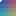

# Pixel conversion first-round quality benchmark

本目录保存像素转换首轮的确定性算法基准。脚本运行四类输入，每类比较 `pixel-art`、`illustration`、`soft-alpha` 三个现有 preset，共 12 个输出。所有变体固定 16 色、`fit=contain`、`dither=none`；三个 16×16 固定素材输出 16×16，仓库真实插画输出 32×32。

打开 [comparison.html](./comparison.html) 可查看放大到约 256px 的三档对照卡片。页面同时显示目标尺寸、色数、透明/半透明像素和机器中位耗时；390px 宽度会自然折成单列。桌面视觉检查截图保存在 `.runtime/qa/pixel-first-round-quality-comparison.png`。

这组结果用于核对实际 `pixelConversion` 转换、`renderPixelFrameRgba` 渲染、RGBA 哈希、PNG 编码和重复运行稳定性，不代表人工画质结论。Palette median-cut split boundary 已修正为保留 dominant 末端 bin（`sorted.length - 1`）；`manualReview` 固定为 `pending`，不会根据误差或耗时推断哪一档观感更好。

| 输入 | pixel-art | illustration | soft-alpha |
| --- | --- | --- | --- |
| 原生硬边 16×16 |  |  |  |
| 透明细线/轮廓 16×16 |  |  |  |
| 半透明渐变 16×16 |  |  |  |
| 仓库真实插画 |  |  |  |

前三类素材由 `scripts/benchmark-pixel-conversion.mjs` 在内存中生成，不作为产品素材写回仓库。真实插画只读取 [`src/assets/sample-summer-character.png`](../../src/assets/sample-summer-character.png)，不修改原文件。PNG 由隔离 Microsoft Edge 页面中的原生 Canvas `toDataURL('image/png')` 编码，所有读取 Canvas context 都声明了 `willReadFrequently: true`。

机器统计见 `pixel-first-round-quality.json`，运行日志见 `.runtime/qa/pixel-first-round-quality.log`。报告只记录尺寸、哈希、调色板规模、透明/半透明像素计数和五次中位耗时，不嵌入完整 PixelDocument、会话或提示词。
