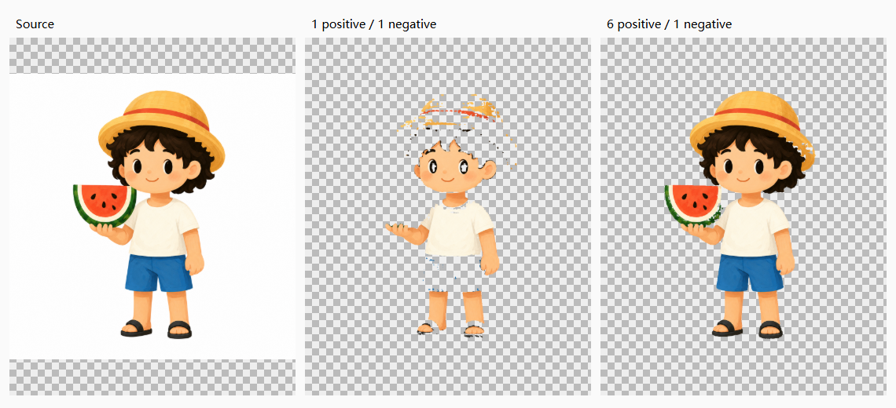

# SAM 本机受管执行对照

2026-10-18，AI-001。固定输入为仓库 `src/assets/sample-summer-character.png`，不是训练集。完整输入/模型/输出 SHA、尺寸和单次耗时见 [result.json](result.json)。



左侧为原图，中间是单点结果，右侧是多点结果。主智能体检查发现：单点遗漏帽子、头发与裤子，多点明显改善主体覆盖，右侧帽檐仍有小缺口。这是一个素材的观察，未进行人工盲审，不据此宣布通用质量通过或替换默认算法。

运行使用现有 cu130 ComfyUI、从旧运行时离线复用的 Impact Pack 8.28.3，以及注册共享根中的 SAM ViT-B。模型没有复制；实际读取前核对固定 SHA。补齐 segment-anything、scikit-image 等依赖后，torch、torchvision、numpy、scipy、Pillow、transformers、tokenizers、safetensors 八项原版本保持一致。没有安装训练器或执行训练。

阈值均为 `0.8`，负向点均为 `(0.05, 0.05)`。单点为 `(0.5, 0.45)`；多点为 `(0.56, 0.15)`、`(0.55, 0.3)`、`(0.53, 0.51)`、`(0.53, 0.7)`、`(0.47, 0.83)`、`(0.32, 0.43)`。坐标按图像归一化。

在已运行且队列空闲的本机 ComfyUI 上复现：

```powershell
node scripts/validate-semantic-sam-live.mjs --report=.runtime/qa/semantic-sam-live-single.json
node scripts/validate-semantic-sam-live.mjs --multi-point --report=.runtime/qa/semantic-sam-live-multi.json
```

脚本读取真实模型，调用隔离产品服务与素材库，核对透明输出和不可变版本。它不启动、停止或中断外部运行时；缺节点、SHA 不符或队列忙时明确停止。报告中的显卡信息是运行环境观测，不能单凭它认定该端点的实际计算设备或独占显存峰值；两次约11.1秒是各自单次端到端观测，不作为P95。

原始报告与运行时停机凭据位于工作区 `.runtime/qa/semantic-sam-live-20261018-*.json` 和 `semantic-sam-live-owned/stopped.json`；此目录保留最小可分享样图与结构记录。SAM、rembg、Qwen的多素材比较、边缘返修成本与人工质量仍由02的AI-001跟进。
