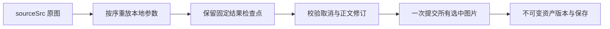

# 光阴砚 AEONQUILL — 图像算法基准与蒙版工作流

> 该文档隶属于[01-开发者文档](../01-开发者文档.md)，用于说明图像算法、蒙版协议与语义编辑流程。
> 本文回答：均衡模式每个图像按钮实际做什么、在哪里执行、需要什么依赖、怎样形成可撤销的新资产版本。

**最后一次更新时间**：2026-10-18

**更新者**：均衡模式责任域、人工智能与算法组、文档专项组

---

## 1. 用户操作路径

```text
在均衡画布选中 image 元件
→ 打开图片实验室
→ 选择工具
→ 调整参数或绘制蒙版/点
→ 查看浏览器草稿或提交正式任务
→ 查看进度和错误
→ 接受结果
→ 画布创建/替换为新的不可变资产版本
```

图片实验室入口：`src/components/ImageLab.tsx`。前端算法：`src/lib/imageProcessing.ts`。服务调用：`src/lib/imageApi.ts`。

---

## 2. 工具总表

| UI 功能 | 实际执行 | 依赖 | 输出 |
| --- | --- | --- | --- |
| 调整 | CSS filter / 浏览器参数预览 | 浏览器 | 非破坏参数或接受后的派生版本 |
| 裁剪 | 浏览器重采样 | 浏览器 Canvas | 派生 PNG |
| 像素化 | 浏览器草稿；正式可走 FFmpeg | Canvas / FFmpeg | 调色板量化 PNG |
| 去背景 | 浅色背景草稿；正式 rembg | Python + rembg + u2netp/u2net | 透明 PNG |
| 元素提取 | 正负点 → SAM | ComfyUI + Impact Pack + SAM | 透明元素 + 灰度蒙版 |
| 区域编辑 | 蒙版 + Qwen Image Edit 2511 | ComfyUI + Qwen 模型 | 局部编辑 PNG |
| 定点修改 | 正负点 → SAM 蒙版 → Qwen | SAM + Qwen | 编辑 PNG + 蒙版 |
| 人像调整 | Qwen 人物一致性提示 | Qwen | 编辑 PNG |
| 区域调整 | 灰度蒙版 + FFmpeg 效果 | FFmpeg | 派生 PNG |
| 蒙版修边 | 浏览器重放 MaskRecipe v2 | Canvas | 新蒙版/派生结果 |
| 放大 | 浏览器草稿、Lanczos 或 Real-ESRGAN | Canvas / FFmpeg / Real-ESRGAN | 放大 PNG |
| 锐化 | unsharp | FFmpeg | 派生 PNG |
| 透明边缘 | Alpha 阈值重映射 | FFmpeg | 派生 PNG |

浏览器草稿不是正式模型结果。UI 必须标明“草稿/本地确定性/模型工作流”，不能用相同按钮外观掩盖能力差异。

---

## 3. 浏览器草稿

`src/lib/imageProcessing.ts` 提供：

- 亮度、对比度、饱和度、色温等 filter 字符串。
- 裁剪与 cover/zoom 重采样。
- Bayer 4×4 抖动像素化预览。
- 浅色背景阈值去除预览。
- 2—4 倍浏览器放大预览。
- MaskRecipe 的低分辨率预览与正式尺寸渲染。

保护限制：

| 项目 | 限制 |
| --- | --- |
| 蒙版预览最大边 | 1024 |
| 蒙版正式输出最大像素 | 24000000 |
| 笔画数 | 512 |
| 总点数 | 20000 |

这些函数用于即时反馈；大图、模型处理和可追溯交付仍由服务端完成。

---

## 4. 确定性图像处理器

实现：`server/image-processor.mjs`，版本 `image-tools-v2`。

| operation | 参数 | 算法 |
| --- | --- | --- |
| `upscale-lanczos` | scale 1.5/2/3/4；sharpen 0—1.5 | Lanczos 缩放 + unsharp |
| `pixelate` | target 16/24/32/48/64/96/128/256；colors 2—64；output 1/2/4/8；dither；alpha | 最近邻缩小、palettegen/paletteuse、最近邻放大 |
| `sharpen` | radius 3/5/7；amount 0.1—2.5 | FFmpeg unsharp |
| `alpha-cleanup` | transparentBelow 0—127；opaqueAbove 128—255 | Alpha 分段重映射 |
| `masked-adjust` | effect；strength 0.1—1；feather 0—32 | 蒙版缩放/羽化后组合 |
| `remove-background` | model；alphaMatting；前后景阈值；erode 0—40 | rembg Python API |
| `upscale-realesrgan` | scale 2/3/4；model；tile 0—1024 | realesrgan-ncnn-vulkan |

`pixelate` 支持的 dither：

```text
none / bayer / floyd_steinberg / sierra2_4a / atkinson
```

`masked-adjust` 支持的效果由服务端注册表给出，当前包含 selection-highlight、background-dim、background-blur。前端不得自行发送未登记字符串。

全局输入限制：

- 单文件最大 20 MiB。
- 输入最大 40000000 像素。
- 输出最大 64000000 像素。

---

## 5. MaskRecipe v2

蒙版不是一张不可解释的临时 PNG；编辑意图保存为可重放配方：

```ts
type MaskRecipe = {
  schemaVersion: 2
  strokes: Array<{
    mode: 'remove' | 'restore'
    size: number
    points: Array<{ x: number; y: number }> // 归一化
  }>
  morphology: {
    expand: number   // -32—32
    feather: number  // 0—32
    trimWeakAlpha: number // 0—127
  }
}
```

生命周期：

```text
指针笔画 → 归一化点 → 内存预览
→ 保存 recipe → 按目标分辨率重放
→ 生成受管灰度/Alpha 蒙版
→ 正式任务消费该蒙版
```

schema v1 仅用于显式读取迁移。未知版本、点数超限、非法坐标或选区为空必须失败关闭。

---

## 6. ComfyUI 语义编辑

能力注册表：`server/semantic-workflow-registry.mjs`，版本 `semantic-image-v2`。

### 6.1 元素提取

| 属性 | 当前值 |
| --- | --- |
| ID | `element-extract` |
| 成熟度 | preview |
| 最低显存 | 4 GB |
| 依赖 | Impact Pack、SAM ViT-B、`SAMLoader` |
| 输入 | 源图、1—32 正向点、0—32 排除点、阈值 0.5—0.99 |
| 输出 | 透明元素、Alpha 蒙版 |

点坐标按图片归一化保存，因此缩放 UI 不改变语义位置。

### 6.2 区域编辑

| 属性 | 当前值 |
| --- | --- |
| ID | `region-edit` |
| 成熟度 | preview |
| 最低显存 | 8 GB |
| 依赖 | Qwen Image Edit 2511 INT8、Qwen 2.5 VL FP8、Qwen VAE |
| 输入 | 源图、蒙版、2—2000 字指令、seed、Alpha/Luma 通道 |
| 输出 | 编辑图 |

模型输出后再次用原始受管蒙版与源图合成；未选区域直接保留源像素，而不是依赖提示词“不要改背景”。

### 6.3 定点修改

`point-edit` 先用 SAM 将正负点编译成蒙版，再执行与区域编辑相同的 Qwen 工作流。输出同时保存编辑图和点选蒙版，便于重放与排错。超时预算 3900 秒。

### 6.4 人像调整

`portrait-adjust` 接受 2—1000 字指令和 0—1 身份强度。当前成熟度为 experimental；能执行不等于人物身份质量已经通过盲审。

---

## 7. 正式任务与资产版本

```text
选择源 image 元件
→ 解析当前项目可见 asset version
→ validateImageRequest / validateSemanticImageRequest
→ JobStore 创建 image 或 semantic job
→ Scheduler 取得 CPU/GPU
→ 执行器只读取受管输入
→ 临时文件输出
→ 探测尺寸/MIME
→ ProjectStore 内容寻址写入
→ 记录 parent version + operation + 参数摘要
→ 前端接受后回填画布
```

原图永不覆盖。重复内容按 SHA-256 复用二进制，但仍可形成不同逻辑版本和 provenance。

Data URL 只允许受限输入导入；不得把原始 Data URL、完整私有路径、来源 URL 或完整提示词写入公开 provenance。

---

## 8. 能力探测与失败

服务启动和用户刷新时探测：

- FFmpeg / ffprobe。
- Python 是否能导入 rembg。
- rembg 模型目录。
- Real-ESRGAN 可执行文件与模型对。
- ComfyUI 节点表与模型枚举。
- 当前 GPU/内存门。

能力不可用时 UI 保留工具说明但禁用正式提交，并给出缺失依赖。浏览器草稿若存在，可作为明确标记的替代预览，不冒充正式结果。

---

## 9. 新增算法的步骤

1. 定义稳定 operation ID、参数精确键、范围、资源类别和依赖。
2. 在前端工具注册表增加说明与参数面板。
3. 若有预览，实现低成本草稿并标记精度边界。
4. 在服务端验证所有字段，拒绝未知参数。
5. 通过 JobScheduler 执行；GPU 能力不得直接 spawn。
6. 只消费受管资产，输出先写临时文件再原子提升。
7. 记录算法/模型/工作流版本、参数摘要、父版本和输出哈希。
8. 增加尺寸上限、取消、超时、非法 MIME、输出缺失和重试测试。
9. 若是局部编辑，加入选区外像素漂移验证。

---

## 10. 验证

```powershell
node --test tests/image-request.test.mjs
node --test tests/image-quality.test.mjs
node --test tests/semantic-image-workflow.test.mjs
node --test tests/semantic-image-quality.test.mjs
npm run validate:api
npm run build
```

画质基准至少记录：

- 输入/输出 SHA-256。
- 工具、模型、节点和参数。
- 分辨率、Alpha 边缘统计。
- P50/P95 耗时和峰值显存。
- 区域编辑的选区外漂移。
- 人工返修次数和主观评分。

---

### 10.1 工作流配方与参数控制

工作流中心提供创作任务卡、配方保存/恢复及同项目完成候选的并排/滑杆比较。图像实验室也可对本地草稿使用滑杆；应用动作仍由用户决定。配方解析会核对工作流与映射 SHA，失效/禁用流程不会直接执行。

`workflowControls.mjs` 是 seed、尺寸、步数、CFG、denoise、LoRA/CLIP 强度和 ControlNet 强度的唯一范围定义。服务端检查映射节点类型、输入名称、数值范围和实际运行时端口类型，不开放任意模型路径。自定义 Job 在排队时固定工作流/映射和参考图内容哈希，实际执行再核对，防止确认后使用不同素材。

固定 H3 配方另保存 `weightSet`：登记版本、FP8/INT8 profile、Base/Turbo 模式，以及底模、文本编码器、双 VAE 和可选 Turbo 加速 LoRA 的 ID/SHA。完整 SHA 的唯一来源为 `workflow-artifacts.mjs`；`video-workflow-registry.mjs` 只引用 artifact ID。识别检查加载节点、精确相对文件名和采样连接；Turbo 加速用途不等同于风格或角色微调。

配方文件 schema v3 显式读取 v1 为 `weightSet: null`，v1/v2 的 loraBindings 均迁入空列表；读取时不覆写旧文件，下一次成功修改才写入 v3。旧配方缺少当前固定 H3 身份时提示重新保存；旧导入 H3 图未登记该集合时需重新导入复检。普通自定义工作流保留现有数值配方，物理权重校验应用于登记的 H3 组合及下述 Qwen Lightning 档。

固定权重请求在排队时记录身份，执行前按运行时注册根校验每一份实际存在的同名候选；任一文件类型、大小或 SHA 不符即拒绝。哈希缓存要求大小、mtime 和 ctime 都未变化，哈希过程中变化也拒绝。成功核验的集合写入 Job metadata 和不可变资产来源；配方页面显示登记身份，运行成功后才形成实际文件验证证据。

本机证据见 `benchmarks/video-quality/fixed-weights-4060-20260926.json`：真实 H3 INT8 Turbo 经此路径生成 124 帧，逐帧解码与同输入/种子的旧基线一致。通用底模家族、风格/角色 adapter 切换和质量推荐仍待扩展及观感校准。

### 10.2 Qwen 固定编辑档位

图像实验室的区域编辑、定点修改与人像调整共享“编辑档位”选择。默认 `base40` 保留原请求和 40 步流程；安装工作流中心的 `image-qwen-edit-2511-lightning4` 包后，可显式选用 `lightning4` 实验档。元素提取不使用此选项；定点修改仍额外需要 Impact SAM。缺文件或节点时禁用快速档，已选档位失效后阻止提交，用户需明确切换，不静默回退。

`src/lib/imageEditPresets.mjs` 是采样参数和版本的唯一来源；`server/workflow-artifacts.mjs` 维护模型大小、SHA 和固定下载来源。四步档使用现有 Qwen INT8 底模、文本编码器及 VAE，额外载入固定 BF16 Lightning LoRA；采样器、CFG、shift、strength 及模型连接均由服务器验证，不开放任意模型或 LoRA 路径。新增的 `params.preset` 只接受两个登记值，旧请求省略时保持标准档。

快速档在任何图片上传和 SAM 执行前，对四份权重执行完整校验；缺验证器、内容变化或不完整验证回执立即失败。Job 和输出资产记录实际档位、工作流版本、LoRA 与已验证 artifact 身份。原标准档的参数和验证行为保持现有契约。

上游参数依据[Comfy-Org 的固定 INT8 2511 模板](https://github.com/Comfy-Org/workflow_templates/blob/98fd32ca756dd9d72077fbe3457146d11cbc88cb/templates/image_qwen_image_edit_2511_int8.json)，LoRA 固定到[模型仓库指定提交](https://huggingface.co/lightx2v/Qwen-Image-Edit-2511-Lightning/tree/d74eba145674fd7e31b949324e148e21e7118abd)。实验档是否适合某类素材，需要同源图实测和人工复核；不能将 40/4 的步数比直接作为本机端到端提速比。

验证入口：`tests/image-edit-presets.test.mjs`、语义工作流/执行器测试和 `scripts/validate-image-edit-presets-ui.mjs`。后者只验界面与请求契约，模型质量另记实际推理证据。

本机固定素材的[对照记录与图片](../../benchmarks/semantic-image-quality/qwen-4060-20260926/README.md)已经保留输入、蒙版与输出 SHA。RTX 4060 Laptop 的单次区域编辑由标准档 1,171.920 秒变为四步档 102.031 秒，选区外像素均保持一致；四步暖运行的人像候选为 58.990 秒。此结果只覆盖一个 H3 生成素材，快速区域样例的 7,798MiB 显存峰值也接近 8GB 上限。矩形选区边界、脸部细节和更广素材仍需复核，不据此切换默认档。

### 10.3 受管 LoRA 与训练前置

工作流中心“LoRA 与参考配方”读取现有 ComfyUI 注册的 loras 根。把 safetensors 放到这些目录后刷新，选择期望家族、风格/角色用途、模型/CLIP强度和触发词，检查后保存绑定。用途是用户标签，不证明模型训练内容；格式/声明家族匹配只做静态筛选，不等于完整张量适配或画面质量。

`server/lora-inspection.mjs` 读取有界 safetensors 头与张量范围、A/B配对和rank，流式SHA；文件类型/真实路径、UTF-8、重复字段、offset重叠/空洞、4MiB头/2GiB文件预算严格失败。只公开白名单metadata和家族依据，未知/矛盾家族不自动当兼容。`loraCompatibility.mjs` 是绑定字段和强度的唯一规范，浏览器使用TextEncoder，不依赖Node Buffer。

`lora-catalog.mjs` 扫描注册根并以稳定modelId登记，绑定保存在工作流目录的原子JSON；损坏不覆盖。`lora-verification.mjs` 供配方create/resolve及Job排队/执行共用：每次重新解析实际文件、family/SHA/全部参数、graph引用与同名遮蔽；扫描不完整时不能证明唯一文件。Qwen执行前另验证登记底模实际artifact，缺文件在唤醒GPU前拒绝。

配方schema3最多两个同家族且角色不同的绑定；当前运行面板一次带入一个映射目标。只有受控工作流已有映射、实际LoRA引用且底模连接可识别时可使用；Qwen必须登记base loader的MODEL输出连到强度映射对应LoRA，孤立加速LoRA不作为底模证据。完整相对子目录名保留，旧H3 weightSet保持原语义。绑定进入Job与不可变输出provenance；不自动接受媒体或标为推荐质量。

接口为 `/api/workflow-center/loras`、`/inspect`、`/bindings`、`/bindings/:id/resolve`，仅接受受管ID，不接受任意客户端路径。结构/大小的唯一上限以对应模块常量为准。

本机无已指定主题、授权数据、caption和训练/验证划分，训练器/训练依赖也尚未配置。按用户最新要求，本轮暂缓实际训练和训练操作入口；不以toy训练或加速LoRA冒充风格/角色训练闭环。已有LoRA导入/校验/配方工程与后续真实质量、人工盲审分别记录。fixture API/UI通过只证明受管链与拒绝门，不代表真实效果。

### 10.4 本地参数效果栈

选择图片后在侧栏管理效果；“编辑参数”复用图像实验室，调整、裁剪和蒙版均可局部重做。processingStack 是唯一权威：可重放本地步骤保存严格 parameters 或 maskRecipe，旧生成结果保存固定检查点；只有相邻可重放步骤可交换，不能跨固定结果。开关、删除、清空和配方批量应用均先重算，再用一个画布命令提交并一次撤销。



旧无参数调整首次编辑时转为显式末尾调整，保持旧CSS渲染顺序；旧裁剪输出保持固定结果。正式裁剪保留原图可用像素与Alpha，640px仅为工具预览。清空旧裁剪时恢复原图比例。重新渲染使用不与历史分支冲突的资产版本；版本分配与logicalAssetId由 canvasAssets.mjs 唯一定义，服务端沿用相同身份。

配方只携带本地参数和归一化蒙版，不携带图片、输出、提示词或路径。复制后应用到所选图片会逐张重算，也可导出/导入JSON。限制与校验以 imageEffects.mjs、maskRecipe.mjs、imageEffectReplay.ts 为准；超过4096边长、1600万单图像素、批次输入/处理/缓存或正文预算时明确拒绝，不静默缩图。锁定、读取失败、取消或较新编辑出现时不提交部分结果。

验证入口为 tests/image-effects.test.mjs、tests/canvas-core.test.mjs、tests/project-store.test.mjs 和 scripts/validate-image-effects-ui.mjs；真实Edge覆盖旧数据、输出顺序、Alpha、批量原子性、取消/失败/过期、保存重开、包体与两种视口。夹具只证明编辑与持久化行为，模型画质仍独立验收。

## 11. 当前限制

- SAM、Qwen 与 Real-ESRGAN 都不是主安装器内置能力。
- 语义编辑的协议纵切已经完成，但真实模型画质仍需固定素材基准。
- 浏览器白底去除不适合复杂头发、半透明物和非白背景。
- Lanczos 只做确定性插值；不能称为生成式超分。
- Qwen 人像调整当前为 experimental，不能承诺绝对身份保持。
