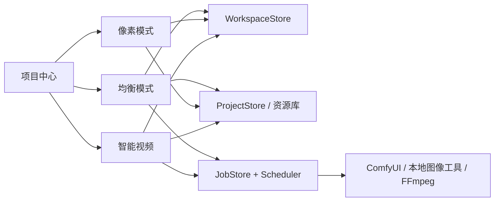

# 光阴砚 AEONQUILL — 开发者文档

> **文档梗概**：面向第一次接触项目的开发者、维护者与测试人员，说明当前可运行能力、用户路径、模块边界、数据协议、扩展入口和验证方法。
>
> **具体规划法则**：
>
> 1. 本文和 01 子文档只描述当前实现，不记录版本流水账。
> 2. 未完成事项统一进入 [02-项目规划](02-项目规划.md)。
> 3. 版本过程、提交证据和阶段结论统一进入 [03-开发历史](03-开发历史.md)。
>
> **最后一次更新时间**：2026-10-18
>
> **更新者**：文档专项组

| 文档属性 | 当前值 |
| --- | --- |
| 产品 SemVer | `0.7.1` |
| 当前功能轨 | `V0.7.105` |
| 文档基线 | `V0.7.66 / DOC-001 已完成` |
| 最后更新 | 2026-10-18 |
| 前端入口 | `src/main.tsx` → `src/ProductApp.tsx` |
| 本地服务入口 | `server/index.mjs` |
| 桌面主壳 | Tauri 2，Electron 仅作兼容后备 |

---

## 目录

- [0. 十分钟理解项目](#0-十分钟理解项目)
- [1. 总体架构](#1-总体架构)
- [2. 技术栈与启动方式](#2-技术栈与启动方式)
- [3. 项目中心与跨模式流程](#3-项目中心与跨模式流程)
- [4. 均衡模式：无限画布与图像工具](#4-均衡模式无限画布与图像工具)
- [5. 像素模式：当前功能地图](#5-像素模式当前功能地图)
- [6. 智能视频：如何使用与如何实现](#6-智能视频如何使用与如何实现)
- [7. 源码目录与模块定位](#7-源码目录与模块定位)
- [8. 核心数据与状态协议](#8-核心数据与状态协议)
- [9. 本地 API 分组](#9-本地-api-分组)
- [10. 存储、配置与输出目录](#10-存储配置与输出目录)
- [11. 开发、验证与构建](#11-开发验证与构建)
- [12. 常见扩展方式](#12-常见扩展方式)
- [13. 常见故障定位](#13-常见故障定位)
- [14. 当前限制](#14-当前限制)
- [15. 深入文档](#15-深入文档)

---

## 0. 十分钟理解项目

光阴砚是本地优先的三模式创作工作台：

| 模式 | 面向任务 | 当前主要能力 | 是否开箱即用 |
| --- | --- | --- | --- |
| 均衡模式 | 无限画布、图像处理、素材编排 | 图片/视频/文字/形状/画框/像素画元件，图像算法，任务结果回填 | 画布与浏览器算法可直接用；ComfyUI 能力需依赖 |
| 像素模式 | 像素绘制、动画、游戏资产 | 多图层、多帧、选区、调色板循环、碰撞区、Terrain、引擎导出 | 核心编辑与导出可直接用 |
| 智能视频 | 从灵感/剧本到镜头和成片 | 十角色生产图、人工审批、本地 H3、声音时间线、最终剪辑 | 规划可直接用；真实生成需安装并启用工作流 |

### 0.1 系统不是三个独立网页

三个模式共享同一个项目目录、资源库、任务系统和本地运行时：



### 0.2 权威数据在哪里

| 数据 | 权威来源 | 不应作为权威的副本 |
| --- | --- | --- |
| 项目目录与三模式正文 | `WorkspaceStore` SQLite | React state、localStorage、client-state |
| 图片、视频、音频资产 | `ProjectStore` 内容寻址文件与 SQLite 元数据 | 画布 URL、临时输入目录 |
| 活动任务 | `JobStore` | 前端进度条 |
| 历史任务 | `JobArchiveStore` | 浏览器缓存 |
| 运行时与工作流状态 | 服务端运行时管理器与工作流中心 | 前端上次检测结果 |
| 用户操作中的临时预览 | 当前编辑器内存 | 不写入正式文档 |

### 0.3 新开发者阅读顺序

1. 本文第 1—6 节：理解架构、项目与三个模式。
2. 找到要修改的子文档：
   - H3 视频：`01-子文档/11-本地H3视频工作流.md`
   - 无限画布：`01-子文档/12-无限画布性能与资源分级.md`
   - 桌面封装：`01-子文档/13-桌面封装与发行架构.md`
   - 图像处理：`01-子文档/14-图像算法基准与蒙版工作流.md`
   - 智能视频：`01-子文档/15-智能视频连续性资产图.md`
   - 声音字幕：`01-子文档/16-智能视频声音字幕时间线.md`
   - 像素编辑：`01-子文档/17-像素动画片段与跨帧编辑.md`
   - 像素图层：`01-子文档/18-像素图层组与确定性混合.md`
   - 游戏资产：`01-子文档/19-逐帧游戏元数据与Tileset规则.md`
3. 修改前查第 11 节的定向验证命令。

---

## 1. 总体架构

### 1.1 进程与职责

| 层 | 主要文件 | 职责 | 明确边界 |
| --- | --- | --- | --- |
| React 产品壳 | `src/ProductApp.tsx` | 项目中心、模式切换、全局对话框、运行时摘要 | 不直接读写磁盘或调用 ComfyUI |
| 模式工作台 | `src/App.tsx`、`src/modes/` | 编辑体验和本地预览 | 正式写入必须走命令或 API |
| 前端领域库 | `src/lib/` | 文档校验、命令、迁移、确定性算法 | 不持有服务器私有路径与密钥 |
| 本地桥接 | `server/index.mjs` | 回环 API、会话、安全校验、SSE | 不接受任意脚本或任意本机路径 |
| 存储层 | `server/workspace-store.mjs`、`server/project-store.mjs` | SQLite、不可变资产、恢复点 | 二进制不进入模式正文 JSON |
| 任务层 | `server/job-store.mjs`、`server/job-scheduler.mjs` | 排队、资源锁、重试、归档、进度 | GPU 任务不得绕过调度器 |
| 能力执行层 | `server/image-processor.mjs`、`server/comfy-client.mjs` 等 | FFmpeg、rembg、Real-ESRGAN、ComfyUI | 只处理受控参数和受管资产 |
| 桌面壳 | `desktop/tauri/src-tauri/src/lib.rs` | 单实例、隐藏 sidecar、随机端口、退出清理 | 不复制业务逻辑 |

### 1.2 一次正式操作的生命周期

```text
用户交互
  → 前端形成经过校验的命令/请求
  → 本地 API 校验会话、项目所有权、revision 和参数
  → 轻量操作：WorkspaceStore 原子写入新 revision
  → 重型操作：JobStore 建任务 → Scheduler 取得资源 → 执行器运行
  → 输出写入 ProjectStore，形成不可变资产版本
  → SSE 推送状态，前端显式接受或绑定结果
```

### 1.3 必须保持的边界

- 浏览器不得直连 ComfyUI。
- 图片、视频、音频不得以 Base64 长期写入正文。
- Agent 不得直接修改 React 状态，也不得替换整份文档。
- 用户可见结果必须先成为项目可见的不可变资产。
- 工作流 JSON、模型名称和输出节点必须由服务端复检。
- 本地桥接只监听回环地址，API 需要随机 HttpOnly 会话。
- 桌面退出只停止由本应用启动并拥有的 ComfyUI 进程。

---

## 2. 技术栈与启动方式

### 2.1 技术栈

| 范围 | 技术 |
| --- | --- |
| 前端 | React 18、TypeScript 5、Vite 6、Lucide React |
| 本地服务 | Node.js ESM、原生 HTTP 路由、SSE |
| 数据 | SQLite + JSON 任务日志 + 内容寻址文件 |
| 桌面 | Tauri 2；Electron 43 为后备封装 |
| 图像/视频 | 浏览器 Canvas、FFmpeg、rembg、Real-ESRGAN、ComfyUI |
| 验证 | Node Test、Playwright、项目定制验证脚本 |

### 2.2 开发启动

```powershell
npm install
npm run app
```

`npm run app` 同时启动 Vite 前端与本地桥接。分别启动时使用：

```powershell
npm run server
npm run dev
```

开发态 Vite 将 `/api` 代理到 `127.0.0.1:8787`。正式桌面由 Tauri 选择随机回环端口并把地址注入前端。

### 2.3 启动成功的最低判断

1. `GET /api/health` 返回健康摘要并建立会话。
2. 项目中心显示“本地服务桥接：已连接”。
3. 未使用视频能力时 ComfyUI 可以保持休眠。
4. 打开模式后能读取或初始化该模式 revision 0 正文。

---

## 3. 项目中心与跨模式流程

### 3.1 创建项目

用户可以从两条路径进入：

```text
创建新项目 → 选择均衡/像素/智能视频 → 初始化正文 → 进入工作台
直接点击模式 → 新建项目或打开已有项目 → 进入工作台
```

创建动作由 `POST /api/workspace/documents/initialize` 完成。目录登记与对应模式的 revision 0 正文位于同一 SQLite 事务；校验失败时不会留下半个项目。

### 3.2 一个项目可以包含多个模式正文

| 项目对象 | 内容 |
| --- | --- |
| 目录记录 | 名称、状态、已启用模式、更新时间 |
| 均衡正文 | `CanvasDocument` |
| 像素正文 | `PixelDocument v9` |
| 智能视频正文 | `SmartVideoDocument v2` |
| 恢复点 | 不可变历史快照，恢复时生成新 revision |
| 资源关系 | 引用全局内容寻址资产，不复制二进制 |

项目可处于 active、archived、trashed 三种状态；回收站默认保留 15 天。

### 3.3 资源库

资源库允许三种模式共享图片、视频、音频和派生版本：

- “加入项目”只增加引用，不复制文件。
- 编辑全局资源时创建派生条目，原件不可原位覆盖。
- 项目正文只保存稳定资产 ID/版本 ID。
- `.aeonquill` 项目包可携带正文、恢复点、资源关系和所需不可变资产。

主要入口：`src/components/Library/AssetLibraryDialog.tsx`、`src/lib/libraryApi.ts`、`server/project-store.mjs`。

---

## 4. 均衡模式：无限画布与图像工具

手动连接支持选择起终点、点击曲线、改向/锁定/删除；多选对齐按旋转视觉边界一次提交，见[画布交互](01-子文档/12-无限画布性能与资源分级.md#13-连接与批量对齐)。

入口：`src/App.tsx`。

### 4.1 画布元件

| 元件 | 能力 | 数据位置 |
| --- | --- | --- |
| poster | 设计稿/海报容器 | `CanvasDocument.elements` |
| frame | 画框和区域组织 | 同上 |
| text | 可编辑文字 | 同上 |
| note | 便签 | 同上 |
| shape | 基础图形 | 同上 |
| image | 受管图片或导入图片 | 元件属性 + 资产版本 |
| video | 受管视频、播放预览 | 元件属性 + 资产版本 |
| pixel | 像素画预览元件 | 元件属性 |
| palette | 调色板 | 元件属性 |
| connector | 元件连接关系 | 元件属性 |

### 4.2 已实现交互

| 交互 | 当前行为 |
| --- | --- |
| 平移/缩放 | 空格或导航模式平移；Ctrl/Meta + 滚轮缩放 |
| 框选 | 使用交互开始时的相机快照，将屏幕矩形映射为世界范围 |
| 多选 | Shift 追加/移除选中项 |
| 拖动/缩放 | 拖动元素，八个手柄缩放 |
| 导入 | 拖放或工具栏导入图片 |
| 视图 | 适应内容、迷你地图、视口裁剪 |
| 历史 | 正式操作以可逆命令形成一次 revision |
| 选中工具栏 | 复制、锁定、置顶、删除 |

连接支持手动创建、改向、锁定和级联删除；多选按旋转后的视觉边界一次对齐。图片“全部工具”打开图像实验室；侧栏效果栈支持本地调整、裁剪与蒙版重放、有限重排和参数配方批量应用。详见[画布交互](01-子文档/12-无限画布性能与资源分级.md#13-连接与批量对齐)与[本地效果栈](01-子文档/14-图像算法基准与蒙版工作流.md#104-本地参数效果栈)。

### 4.3 图像工具

| 类别 | 功能 | 执行位置 | 正式结果 |
| --- | --- | --- | --- |
| 浏览器草稿 | 调整、裁剪、像素化预览、白底去除预览 | 浏览器 | 接受后形成新版本或参数 |
| 确定性服务 | Lanczos 放大、像素化、锐化、Alpha 清理、蒙版调整 | 本地服务/FFmpeg | 新不可变资产 |
| 专用模型 | rembg、Real-ESRGAN | 本地 Python 工具 | 新不可变资产 |
| ComfyUI 语义编辑 | 元素提取、区域编辑、定点编辑、人像调整 | 固定工作流 | 新不可变资产 + provenance |

完整参数、依赖和修改入口见 [14-图像算法基准与蒙版工作流](01-子文档/14-图像算法基准与蒙版工作流.md)。

---

## 5. 像素模式：当前功能地图

入口：`src/modes/pixel/PixelModeWorkbench.tsx`。正文协议：`PixelDocument schema v9`。原生 `.ase/.aseprite` 导入/导出保留支持的帧、图层、颜色、时长、标签和关联 Cel；完整保留范围见[像素互通](01-子文档/17-像素动画片段与跨帧编辑.md#16-aseprite-互通)。

### 5.1 绘制与选区

| 功能 | 操作/快捷键 | 实现状态 |
| --- | --- | --- |
| 铅笔 | `B` | 已实现 |
| 橡皮 | `E` | 已实现 |
| 填充 | `G` | 已实现 |
| 吸管 | `I` | 已实现 |
| 直线 | `L` | 已实现 |
| 矩形 | `R` | 已实现 |
| 框选 | `M` | 已实现 |
| 画笔尺寸 | 1—4 | 已实现 |
| 像素完美笔触 | 一像素铅笔开关 | 已实现，孤立角点清理 |
| 对称绘制 | 水平/垂直 | 已实现 |
| 网格/缩放 | UI 控制 | 已实现 |
| 选区移动 | 方向键 | 已实现 |
| 旋转与缩放 | 选区面板 | 精确90度/任意角、nearest、预览后一次撤销 |
| 系统剪贴板 | Ctrl/Meta + Shift + C/V | PNG/精确RGBA文本、跨项目、权限错误可恢复 |
| 复制移动 | Alt + 方向键 | 已实现 |
| 剪切/复制/粘贴 | Ctrl + X/C/V | 已实现，支持跨帧 |
| 翻转/清除 | 选区工具栏 | 已实现 |

像素不是 DOM 元素。每个 Cel 使用固定长度的像素 ID 数组，绘制命令只记录变化范围。

图片转换提供像素素材、插画缩小和柔和透明边缘预设，支持面积采样、Oklab 与半透明调色板。先异步生成候选，再明确应用；完整转换可一次撤销或重做。参数与失败边界见[图片转换说明](01-子文档/17-像素动画片段与跨帧编辑.md#4-图像转像素)。

大文档地形预览按实际依赖帧传递像素，大正文上传使用等价 UTF-8 Blob；原30分钟控制与资源门已通过。实际输入指标及剩余成本见[Worker与性能说明](01-子文档/17-像素动画片段与跨帧编辑.md#131-大文档-worker)。

### 5.2 图层、动画和调色板

| 范围 | 已实现能力 |
| --- | --- |
| 图层组 | 新建、删除、重命名、显隐、锁定 |
| 图层 | 新建、删除、排序、显隐、锁定、透明度、分组 |
| 混合 | normal、multiply、screen、add |
| 帧 | 新建、复制、删除、时长、播放、洋葱皮 |
| 动画片段 | 起止帧、正放/倒放/往返、循环、批量时长 |
| 动画事件 | marker、sfx、hit、custom |
| 调色板 | 替换、循环、正放/倒放/往返、步长 |

### 5.3 游戏资产能力

- 每帧锚点。
- solid、hitbox、hurtbox、interaction 碰撞矩形。
- 8 邻域 Terrain 规则与 3×3 预设。
- 多 Terrain 地图，最多 16 张、每边 1—64、最多 4096 格。
- 八方向补齐。
- 导出当前帧、Sprite Sheet、片段包、游戏包、Terrain PNG/JSON/TMJ。
- Godot 4.x、Unity 2021.2+、RPG Maker MZ 导入桥。

完整编辑路径见 [17-像素动画片段与跨帧编辑](01-子文档/17-像素动画片段与跨帧编辑.md)，图层合成见 [18-像素图层组与确定性混合](01-子文档/18-像素图层组与确定性混合.md)，游戏交付见 [19-逐帧游戏元数据与Tileset规则](01-子文档/19-逐帧游戏元数据与Tileset规则.md)。

---

## 6. 智能视频：如何使用与如何实现

入口：`src/modes/video/SmartVideoWorkbench.tsx`。正文协议：`SmartVideoDocument schema v2`。

### 6.1 是否开箱即用

| 能力 | 无模型时 | 需要的外部能力 |
| --- | --- | --- |
| 输入灵感/剧本并拆场景 | 可用 | 无 |
| 建立十角色生产图 | 可用 | 无 |
| 人工编辑、暂停、审批、返修 | 可用 | 无 |
| 文本 Agent 辅助四类节点 | 不可用 | 用户配置 OpenAI-compatible API |
| 真实图片/视频生成 | 不可用 | ComfyUI + 对应节点/模型/工作流 |
| 声音生成 | 取决于适配器 | 本地或 API TTS Adapter |
| 最终剪辑 | 可用但需要已有镜头/声音 | FFmpeg |

因此，“规划和编辑”开箱即用，“真实生成”不是无条件开箱即用。工作流中心会检测依赖并引导安装；不会把缺少模型的降级结果伪装成 H3 高质量输出。

### 6.2 用户最短路径

```text
1. 新建“智能视频”项目
2. 输入灵感或结构化剧本，选择比例和目标时长
3. 编译场景、角色、地点和镜头
4. 在“制片”查看十个节点，逐节点编辑/提交复核/批准
5. 为角色、服饰、场景和参考帧绑定资源库资产
6. 在“执行”选择镜头、T2V/I2V、极速或质量预设
7. 确认依赖清单和运行摘要，提交 H3 任务并逐镜复核
8. 配置声音字幕，生成最终 720P 成片
```

### 6.3 十角色生产图

| 顺序 | 角色/节点 | 主要产物 | 前置依赖 |
| --- | --- | --- | --- |
| 1 | 制片统筹 | 总体计划 | 无 |
| 2 | 编剧 | 剧本 | 制片统筹 |
| 3 | 人物设计 | 人物与服饰设定 | 编剧 |
| 4 | 艺术指导 | 场景与视觉规则 | 编剧 |
| 5 | 分镜导演 | 镜头表 | 人物、场景 |
| 6 | 素材制作 | 角色/场景/首尾帧资产 | 分镜 |
| 7 | 视频导演 | H3 镜头候选 | 素材 |
| 8 | 剪辑师 | 镜头顺序与剪辑 | 视频镜头 |
| 9 | 声音导演 | 配音、音乐、字幕时间线 | 剪辑 |
| 10 | 质检 | 交付检查与结论 | 画面、声音、剪辑 |

节点状态为 waiting、ready、running、paused、review、approved、revision、failed。上游内容变更会使相关下游结果失效；系统不会越级自动批准。

### 6.4 生成链路

- 单镜头支持 T2V、首帧 I2V、首尾帧 I2V。
- 连续长片的第一镜可用 T2V，后续镜头可从上一条受管 MP4 提取真实末帧再提交 I2V。
- 每个镜头可以保存多个真实 MP4/WebM 候选；登记候选不会自动选中。
- 人工复核必须绑定具体候选和当前输入指纹，提示词或参考资产变化后旧结论会过期。
- 最终成片只接受已完成的受管 Job ID，不接受前端传入任意磁盘路径。

完整状态机、数据协议和扩展方式见 [15-智能视频连续性资产图](01-子文档/15-智能视频连续性资产图.md)。声音与字幕见 [16-智能视频声音字幕时间线](01-子文档/16-智能视频声音字幕时间线.md)。H3 预设见 [11-本地H3视频工作流](01-子文档/11-本地H3视频工作流.md)。

---

## 7. 源码目录与模块定位

```text
src/
  ProductApp.tsx                  产品壳、项目与模式路由
  App.tsx                         均衡模式
  components/                     画布、图像、视频和首页组件
  modes/pixel/                    像素工作台
  modes/video/                    智能视频工作台
  lib/canvas*.mjs                 画布协议、命令、空间索引
  lib/pixel/                      PixelDocument、算法、导出
  lib/project/                    项目、资源库和 API 客户端
  lib/story/                      生产图、连续性、声音和执行
  lib/agent/                      CreativePlan 与 Agent 边界
server/
  index.mjs                       API 入口、安全和 SSE
  workspace-store.mjs             三模式正文与恢复点
  project-store.mjs               不可变资产与资源库
  job-store.mjs                   活动任务
  job-scheduler.mjs               CPU/GPU 调度
  workflow-center.mjs             内置能力包与安装状态
  custom-workflow.mjs             自定义 ComfyUI JSON 门控
  runtime-manager.mjs             ComfyUI 生命周期
  image-*.mjs                     图像算法与语义编辑
  video-*.mjs                     H3、连续镜头、剪辑与质检
  sound-*.mjs                     TTS、混音和字幕
  workflows/                      固定 H3 API 模板
desktop/
  tauri/src-tauri/                主桌面壳
  electron/                       后备桌面壳
  release/                        构建身份和发行脚本
tests/                             领域与服务单元测试
scripts/                           纵切、浏览器、发行和文档验证
doc/                               总纲、开发者文档、规划和历史
```

### 7.1 修改需求到代码入口

| 需求 | 首要入口 | 同时检查 |
| --- | --- | --- |
| 新增画布元件 | `src/lib/canvasCore.mjs` | `CanvasElementView`、Inspector、序列化、命令测试 |
| 修复框选/缩放 | `src/components/CanvasWorkspace.tsx` | `canvasSpatialIndex.mjs`、浏览器回归 |
| 新增图片算法 | `src/lib/imageProcessing.ts` | `ImageLab`、`server/image-processor.mjs`、Job 路由 |
| 调整像素画工具 | `PixelModeWorkbench.tsx` | `pixelCore.mjs`、`pixelTools.mjs`、迁移与导出 |
| 新增像素文档字段 | `pixelCore.mjs` | `.d.mts`、版本迁移、所有导出器和测试夹具 |
| 修改智能视频节点 | `productionPipeline.mjs` | `ProductionStudio.tsx`、督导、正文迁移 |
| 新增 H3 预设 | `video-workflow-registry.mjs` | builder、工作流中心、提交校验、UI 标签 |
| 新增 Comfy 工作流包 | `workflow-center.mjs` | 固定哈希、许可、映射、真实节点复检 |
| 新增 API Adapter | `server/generation-adapter.mjs` | 服务端凭据边界、UI 配置、脱敏测试 |
| 修改桌面启动 | `desktop/tauri/src-tauri/src/lib.rs` | sidecar 身份、单实例、退出清理、桌面纵切 |

---

## 8. 核心数据与状态协议

客户端先完成项目目录及完整正文恢复，再挂载编辑器。`projectApi.ts` 使用写尝试与读取序号保护 revision：迟到读取不能改写待保存草稿的基准，历史恢复先等待已有写队列终态。像素待保存副本的释放与恢复见[像素编辑器](01-子文档/17-像素动画片段与跨帧编辑.md#132-草稿持久化与释放)。

### 8.1 CanvasDocument

实现：`src/lib/canvasCore.mjs`。

- schema v1。
- 最多 5000 个元件。
- 权威命令：`elements.add`、`elements.patch`、`elements.remove`、`elements.replace`、`camera.set`、`document.reset`。
- 高频拖动只更新预览；指针结束时提交一次命令。
- 坐标区分屏幕坐标和世界坐标，任何选区提交都必须使用同一相机快照。

### 8.2 PixelDocument

实现：`src/lib/pixel/pixelCore.mjs`，类型：`pixelCore.d.mts`。

- 当前 schema v9。
- palette、paletteCycles、layerGroups、layers、frames/cels、celLinks、animationTags、animationEvents、terrainMaps 均为正文事实。
- 所有持久修改经严格候选校验和可逆命令。
- 播放、洋葱皮和循环预览是瞬态状态，不增加 revision。
- 未识别的新 schema 必须失败关闭；旧 schema 只能走显式迁移。

### 8.3 SmartVideoDocument

实现：`src/lib/story/storyProject.mjs`、`productionPipeline.mjs` 等。

- 当前 schema v2。
- 包含 StoryProject、GenerationPlan、VideoProductionProject。
- 生产正文当前 schema v6，连续性图 schema v2。
- 素材节点保存稳定资产引用，不保存任意本机路径。
- 审批、暂停、返修和下游失效都必须可序列化。

### 8.4 Job

实现：`server/job-store.mjs`、`server/job-scheduler.mjs`。

```text
queued → running → completed
                ↘ failed
queued/running → cancelled
```

任务必须携带 kind、项目身份、参数摘要、资源类别、优先级、幂等键和执行身份。RTX 4060 的 GPU 容量为 1；父级 video-chain 不占 GPU 槽等待子任务。

### 8.5 CreativePlan v1

实现：`src/lib/agent/creativePlan.mjs`、`server/agent-plan-composer.mjs`。

```text
用户指令 → 服务端读取权威正文 → 有界上下文 → 模型返回结构化步骤
→ 本机严格校验 → 副本预演 → 用户批准计划哈希
→ 服务端重读正文并原子提交 → 回执
```

密钥只存在服务端进程内存；浏览器不读取密钥。计划过期、revision 漂移、未知工具或媒体 URL 会失败关闭。

---

### 8.6 工作流配方与媒体提议

MediaRun 的可选 preparation 只保存图像工作流/双参考ID与SHA，或配音预算。确认提议从该描述符恢复输入并重验当前资产版本与请求指纹，刷新不丢用户选择；秘密、路径和完整请求仍不持久化。旧无描述符记录保持严格重算/过期拒绝，不猜历史输入。

工作流配方 schema3 可附受管 LoRA 的 family/SHA/角色/强度绑定，旧 v1/v2 显式迁入空列表；文件检查、配方与执行复核见[LoRA 管理](01-子文档/14-图像算法基准与蒙版工作流.md#103-受管-lora-与训练前置)。

工作流中心默认从“创作任务”进入已启用流程，可保存参数配方、恢复运行参数，并比较同一项目的两个完成候选。图像实验室的本地草稿也支持并排/滑杆对比。配方只保存工作流与映射哈希和受控数值参数，不保存提示词、参考图或凭据；图像输入继续由当前项目提供。

参数权威定义为 `src/lib/workflowControls.mjs`；配方校验和存储分别为 `src/lib/workflowRecipes.mjs`、`server/workflow-recipe-store.mjs`。LoRA/ControlNet 目前只调节固定、已检查工作流中的强度；不提供任意权重替换或未验证模型家族的兼容承诺。

制片正文 v6 新增 `mediaRuns`。图像、H3、配音、混音、成片均经过“提出 → 确认 → 受管任务 → 人工复核”，严格绑定项目、文档、提议 ID 与请求哈希。素材、工作流或参数变化后需要重新检查。详见[生产图](01-子文档/15-智能视频连续性资产图.md)与[声音时间线](01-子文档/16-智能视频声音字幕时间线.md)。

视频正文编解码集中在 `src/lib/story/smartVideoDocument.ts`，首页在打开/恢复视频文档时动态加载；视频工作台向产品壳同步提供已校验序列化正文，使自动保存和 `flushWorkspaceModeDocument` 仍使用同一写入队列。

## 9. 本地 API 分组

所有 API 都位于 `server/index.mjs`，以下是定位表，不是完整 OpenAPI 定义。

| 分组 | 代表路由 | 用途 |
| --- | --- | --- |
| 健康与运行时 | `/api/health`、`/api/runtime/status`、`/api/runtime/start` | 会话握手、ComfyUI 检测与生命周期 |
| 工作流中心 | `/api/workflows/catalog`、安装/启用/停用路由 | 能力包和自定义 JSON |
| Workspace | `/api/workspace/catalog`、`/documents/initialize`、正文读写 | 项目目录和三模式正文 |
| 恢复与包体 | recovery、package preview/export/import | 恢复点与 `.aeonquill` |
| 资源库 | collections、assets、versions、derive | 跨模式资产 |
| 图像 | `/api/image-tools/`、semantic workflows | 算法任务和语义编辑 |
| 视频 | prompt compile、video jobs、video-chain、final-cut | H3、连续镜头和成片 |
| 声音 | speech、sound render、subtitle | TTS、混音和字幕 |
| Agent | adapters、compose、commit、supervisor | 有界计划与智能视频督导 |
| Job | jobs、events、retry、cancel、archive | 状态、SSE 和历史 |
| 诊断 | diagnostic bundle | 白名单脱敏报告 ZIP |

安全要求：

- 仅回环监听。
- 首次健康握手建立 HttpOnly 会话。
- 后续请求校验 Host、Origin/Fetch Metadata 和会话。
- 公开响应不得暴露绝对路径、密钥、完整提示词或私有媒体内容。

---

## 10. 存储、配置与输出目录

### 10.1 源码开发态

默认根目录为 `.runtime/`：

| 路径 | 内容 |
| --- | --- |
| `.runtime/data/workspaces/` | Workspace SQLite |
| `.runtime/data/projects/` | ProjectStore SQLite 与资产 |
| `.runtime/data/jobs.json` | 活动任务 |
| `.runtime/data/job-archive.json` | 历史任务 |
| `.runtime/inputs/` | 执行期输入 |
| `.runtime/assets/` | 执行期输出与受管资产 |
| `.runtime/cache/` | 预览、诊断等缓存 |
| `config/local.json` | 本机私有配置，不提交 Git |
| `output/` | 用户未指定目录时的默认交付副本 |

### 10.2 便携桌面态

```text
安装根/
  光阴砚 AEONQUILL.exe
  output/
  UserData/
    data/
    runtime/
    cache/
    logs/
    config/local.json
    EBWebView/
```

用户在设置中选择输出目录后，完成品复制到该目录；没有选择时使用软件根目录下的 `output/`。副本失败不得破坏项目内的正式资产。

### 10.3 ComfyUI 发现顺序

1. `config/local.json` 的显式路径。
2. 对应 `AEONQUILL_*` 环境变量。
3. C/D 盘常见 ComfyUI 根目录的受限扫描。

候选目录必须同时存在 `main.py` 和可执行 Python。示例配置见 `config/local.example.json`。

---

## 11. 开发、验证与构建

### 11.1 基础命令

| 目的 | 命令 |
| --- | --- |
| 单元测试 | `npm run test:unit` |
| 全量源码验证 | `npm run validate` |
| 快速验证 | `npm run validate:quick` |
| API 纵切 | `npm run validate:api` |
| 浏览器纵切 | `npm run validate:browser` |
| P7 集成链 | `npm run validate:p7` |
| 前端构建 | `npm run build` |
| 文档验证 | `npm run validate:docs` |

### 11.2 按修改范围选择验证

| 修改范围 | 最低验证 |
| --- | --- |
| 画布交互 | canvas 单测 + browser canvas 验证 + `npm run build` |
| 图像算法 | image request/quality 单测 + API 纵切 |
| PixelDocument | pixel core/tools/conversion/game 全组单测 + build |
| 智能视频状态机 | story/production/continuity/supervisor 单测 + browser/API 纵切 |
| H3/工作流 | registry/builder/custom workflow 单测 + P7 相应阶段 |
| 声音与剪辑 | sound/finalizer 单测 + 受管媒体纵切 |
| 存储/项目包 | workspace/project/package 单测 + API 纵切 |
| 桌面启动 | sidecar 校验 + 单实例/隐藏启动/退出清理纵切 |
| 文档 | `npm run validate:docs` + 文档体系校验器 |

测试文件位于 `tests/`，专项脚本位于 `scripts/`。新增协议字段时必须同时新增：合法夹具、非法输入、旧版迁移、序列化往返和下游导出验证。

---

## 12. 常见扩展方式

### 12.1 新增画布元件

1. 在 `canvasCore.mjs` 增加 kind、属性校验和迁移。
2. 在 `CanvasElementView` 增加渲染和命中区域。
3. 在 Inspector 和创建工具中增加编辑入口。
4. 通过统一命令写入，补充 undo/redo。
5. 验证保存、恢复、框选、缩放、迷你地图和性能裁剪。

### 12.2 新增图像处理器

1. 在图像工具注册表定义参数和依赖。
2. 在 `ImageLab` 提供参数 UI；浏览器预览与正式处理明确分开。
3. 在服务端加入白名单请求校验和 Job kind。
4. 执行器只读取受管资产，输出写入 ProjectStore。
5. 记录算法版本和脱敏 provenance，补充尺寸/格式/失败测试。

### 12.3 修改 PixelDocument

1. 提升 schema 版本并写单向显式迁移。
2. 同步 `.d.mts` 类型与严格验证器。
3. 把修改实现为可逆命令。
4. 复核画布预览、项目保存、Sprite、游戏包、Terrain 和三类引擎桥。
5. 未知未来版本必须拒绝，不得按当前版本猜测读取。

### 12.4 新增视频预设或工作流

1. 在统一视频注册表登记真实生成尺寸、交付尺寸、显存、内存、依赖和估时。
2. 工作流模板只保存受控占位，不暴露任意节点修改。
3. 服务端提交时重新校验模型、节点、工作流哈希和输出映射。
4. UI 明确展示“原生生成”与“后处理交付”。
5. 在目标硬件上记录峰值显存、总时长、失败阶段和实际文件探针。

### 12.5 新增 Agent/外部 API

1. 凭据只进入服务端内存。
2. 定义输入披露预算、超时、响应大小和严格 JSON schema。
3. 只允许映射为已有安全命令。
4. 默认进入预览/审批，不自动写入正文或自动批准。
5. 日志、诊断和回执不得包含密钥或完整私有内容。

---

## 13. 常见故障定位

| 现象 | 先检查 | 常见原因 |
| --- | --- | --- |
| 项目打不开 | Workspace 文档 revision、模式登记 | catalog-only 旧记录或 revision 冲突 |
| 工作流中心显示缺失 | 重新检测、运行时根、extra model paths、节点 | 只检测了错误根目录或共享模型未登记 |
| 8 GB 显存被判不足 | 注册表显存值和容差 | 浮点/单位比较未使用 0.0625 GB 容差 |
| 启动出现终端窗口 | Tauri sidecar 启动 flags | 使用了可见控制台宿主或重复启动 |
| 框选预览从左上角出现 | CSS left/top、相机快照 | 把几何 x/y 当作未定位 CSS 属性 |
| 视频模糊 | 原生尺寸、预设、后处理报告 | 低清 Turbo 结果被误当原生 720P |
| H3 任务找不到模板 | sidecar 资源闭包 | `server/workflows/*.json` 未打入封包 |
| 输出找不到 | 设置中的输出目录、项目资产 | 交付副本失败或用户只查看外部副本 |
| ComfyUI 不自动关闭 | runtime policy、活动队列、进程所有权 | persistent 策略或仍有活动 Job |
| Agent 修改失败 | base revision、plan hash、工具边界 | 计划过期、正文变动或出现未知工具 |

---

## 14. 当前限制

- 三类原生编辑器的双向导入还不是当前正式能力。
- Qwen/SAM/SeedVR2 等能力包只有在模型、节点和许可均满足后才可执行；“目录中存在文件”不等于能力可用。
- H3 质量模式在 8 GB 设备上可以运行，但耗时、共享内存和模型卸载行为必须按本机实测确认。
- 文本 Agent 只辅助编剧、人物、艺术指导和分镜四类文本节点；不会自动批准或伪造媒体产物。
- 字幕和声音链已接入本地 WhisperX 对齐、词时间预览及局部交叉淡化试听；对齐需另行安装并校验模型，口型同步尚未实现。
- 工作流中心的自定义 JSON 仅支持受控 API prompt，不是完整 ComfyUI 前端替代品。
- Electron 不是主发行路径；新增业务只实现一次并通过本地 API 共享。

---

## 15. 深入文档

| 文档 | 回答的问题 |
| --- | --- |
| [11-本地H3视频工作流](01-子文档/11-本地H3视频工作流.md) | H3 预设、T2V/I2V、720P、运行时和工作流如何实现 |
| [12-无限画布性能与资源分级](01-子文档/12-无限画布性能与资源分级.md) | 坐标、框选、命令、空间索引和资源加载如何实现 |
| [13-桌面封装与发行架构](01-子文档/13-桌面封装与发行架构.md) | Tauri、sidecar、便携目录、单实例和发行边界如何实现 |
| [14-图像算法基准与蒙版工作流](01-子文档/14-图像算法基准与蒙版工作流.md) | 每个图像按钮执行什么、依赖什么、输出什么 |
| [15-智能视频连续性资产图](01-子文档/15-智能视频连续性资产图.md) | 从灵感到成片、十角色状态机、候选和人工审批如何实现 |
| [16-智能视频声音字幕时间线](01-子文档/16-智能视频声音字幕时间线.md) | TTS、声音绑定、混音、字幕和最终剪辑如何实现 |
| [17-像素动画片段与跨帧编辑](01-子文档/17-像素动画片段与跨帧编辑.md) | 像素编辑器具体有哪些工具、快捷键和动画能力 |
| [18-像素图层组与确定性混合](01-子文档/18-像素图层组与确定性混合.md) | 图层组、锁定、透明度、混合和渲染一致性如何实现 |
| [19-逐帧游戏元数据与Tileset规则](01-子文档/19-逐帧游戏元数据与Tileset规则.md) | 碰撞区、Terrain、Tileset 和引擎交付如何实现 |

文档治理入口：

- [00-项目总纲](00-项目总纲.md)：产品目标、边界和决策。
- [02-项目规划](02-项目规划.md)：未完成任务、优先级、验收标准。
- [03-开发历史](03-开发历史.md)：已完成版本、提交和证据。
