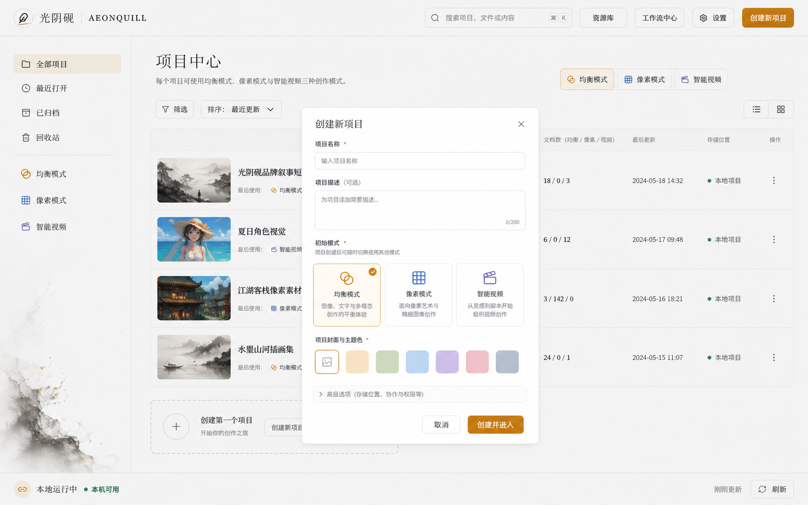

# 光阴砚 AEONQUILL — V0.7 项目平台与智能创作路线

> 该文档隶属于[02-项目规划.md 第 7 节](../02-项目规划.md#7-中长期优化路线)，用于冻结 2026-08-26 已确认的产品决策、实施顺序与阶段验收边界。

## 目录

1. [阶段定位](#1-阶段定位)
2. [已确认的产品决策](#2-已确认的产品决策)
3. [长期架构主线](#3-长期架构主线)
4. [实施里程碑](#4-实施里程碑)
5. [首个旗舰纵切](#5-首个旗舰纵切)
6. [质量与发布门禁](#6-质量与发布门禁)
7. [明确排除项](#7-明确排除项)
8. [风险与刹车机制](#8-风险与刹车机制)

## 1. 阶段定位

`V0.7.x` 的目标不是继续堆叠孤立按钮，而是把现有均衡、像素与智能视频三条原型收束为同一套“项目—文档—资源—工作流—智能体”产品底座。目标用户优先是拥有 RTX 4060 级个人设备的本地创作者；创作范围覆盖图像设计、像素资产、广告视频与叙事视频，不把产品限制为短剧工具。

本阶段结束时，用户应能创建多个真实项目，在同一项目中进入任意模式、管理多份模式文档和复用资产；随后选择本地工作流或自带 API 完成一条可暂停、可修改、可恢复、可追溯的约 20 秒旗舰视频纵切。



上图只定义项目中心的信息架构、视觉密度和对话框层级；所有按钮、文字、筛选与项目状态必须由 React 组件和真实状态实现，禁止把概念图作为静态页面交付。

## 2. 已确认的产品决策

| 领域 | 已确认方案 | 强制边界 |
| --- | --- | --- |
| 项目入口 | “创建新项目 → 选择初始模式 → 进入”和“点击模式 → 新建/打开项目 → 进入”两条入口汇合 | 初始模式只决定第一个文档，不锁定项目能力 |
| 项目内容 | 一个项目可使用三种模式，每种模式可有多份文档 | 禁止继续以三套单例草稿冒充项目系统 |
| 项目存储 | 内部数据库为权威来源，同时支持导出完整项目包；默认根为 `UserData/Projects` 且可配置 | 项目删除先进入 15 天回收站；共享全局资产不得随项目误删 |
| 资源库 | 项目资源库与全局资源库并存；用户显式加入；支持标签、集合、搜索、来源与版本 | 全局资产进入项目建立引用，编辑时创建项目派生版本，不覆盖原件 |
| 工作流 | 内置标准目录、按需下载、依赖探测、推荐组合包和自定义 ComfyUI JSON 导入向导 | 不执行未经节点、模型、路径、网络和输入输出映射检查的任意工作流 |
| 视频自动化 | 用户进入时手选极速或质量，系统给出推荐；项目默认配置允许单镜头覆盖 | 极速模式也必须显示真实降级；质量模式优先画质且允许长时间运行 |
| 人物约束 | 快速模式采用单张人物参考；专业模式采用角色设定、三视图/多角度、表情与服饰状态 | 剧本中的场景或服饰变化必须形成显式状态，不静默漂移 |
| 多智能体 | 制片总览 + 独立角色会话 + 结构化变更卡；导演提供阻塞、预计时间与下一步摘要 | 已审批产物不得被智能体静默覆盖；正式修改由用户应用变更卡 |
| 外部能力 | 本地 ComfyUI 与用户自带密钥 API 并存；首批覆盖文本、图像、视频与 TTS 适配器 | 当前周期不建立云端代付、积分或密钥代理 |
| 发行 | 当前先做源码、浏览器和真实纵切测试；后续改为轻量应用框架 + 工作流/模型按需下载 | 不重建现有 69GB 单体下载包，不在本周期提前封包 |

## 3. 长期架构主线

```text
ProjectCatalog
└── ProjectWorkspace
    ├── ModeDocument[]
    │   ├── balanced: CanvasDocument
    │   ├── pixel: PixelDocument
    │   └── smart-video: ProductionDocument
    ├── ProjectAssetReference[]
    ├── WorkflowBinding[]
    ├── RecoveryPoint[]
    └── AgentChangeCard[]

GlobalAssetLibrary
└── ContentAddressedAsset → immutable AssetVersion[]

WorkflowCenter
└── Runtime → WorkflowPack → ModelPack → CapabilityReport
```

核心约束：

1. `ProjectWorkspace` 是模式间共享上下文的唯一项目身份；路由、保存、最近项目和任务均携带 `projectId` 与 `documentId`。
2. 模式文档只保存结构化数据和资产版本引用，不把图片、视频或大型像素二进制塞入目录 JSON。
3. 资产以内容哈希去重，修改形成不可变派生版本；资源库负责组织和引用，不复制大文件。
4. 工作流中心只交付经过 manifest、哈希、许可证、显存和依赖检查的能力包；运行时与模型允许共享去重，冲突版本采用隔离环境。
5. 用户操作、智能体变更卡和自动工作流最终都必须通过受控命令或任务协议，不直接改写 React 状态、数据库或任意文件路径。

## 4. 实施里程碑

| 顺序 | 里程碑 | 主要结果 | 退出门禁 |
| --- | --- | --- | --- |
| P0 | 多项目底座 | 项目中心、新建/打开、搜索/归档/回收站、三模式共享 `projectId`、多文档与恢复点 | 至少创建两个项目并证明内容、最近入口和重载恢复互不串写 |
| P1 | 双层资源库 | 项目/全局资源、显式加入、搜索标签、引用/派生版本、跨模式取用 | 同一资产在三个模式中引用且只保留一份内容；派生不覆盖原件 |
| P2 | 工作流中心 | 依赖探测、目录、按需下载、推荐组合、安装校验、自定义 JSON 向导 | 缺依赖可解释；损坏包不启用；未知节点与不安全路径失败关闭 |
| P3 | Agent 制片室 | 制片总览、角色会话、变更卡、审批门、极速/质量和人物快/专业管线 | 上游返工使下游失效；已审批内容不被静默改写；暂停后可恢复 |
| P4 | BYOK 适配器 | OpenAI-compatible 文本接口及通用图像、视频、TTS 适配层 | 密钥不进项目包/日志；适配器不可用时本地手工链仍可操作 |
| P5 | 旗舰视频纵切 | 约 20 秒、16:9、720P 武侠品牌叙事广告，全链路生成与粗剪 | 四个 5 秒镜头、旁白、字幕、BGM/原生音频可追溯并可逐节点重做 |
| P6 | 像素专业链 | 动画时间线、Sprite、Tileset/Tilemap、八方向、游戏引擎导出与 AI 清理 | 固定项目导出后可在目标引擎/通用查看器复现帧、锚点和图块映射 |
| P7 | 集成与桌面更新 | 全链路回归、性能/恢复/错误验证，随后更新 D 盘正式测试应用 | 源码与浏览器 QA 通过后才构建；用户数据、output 与旧项目保持完整 |

P0—P2 是后续智能化的基础设施；P3—P5 形成可展示的旗舰生产能力；P6 独立强化像素模式；P7 只在前述结果稳定后执行。未通过退出门禁时不得仅因日期推进里程碑。

### 4.1 P0 完成状态（V0.7.3）

三轮可运行切片已经完成 P0。`ProjectCatalog` v1、项目/文档全局唯一 ID、项目中心、创建与初始模式选择、搜索和模式过滤、归档、回收站、15 天清理，以及同项目显式新增/打开另一模式文档全部保留。V0.7.3 新增 `WorkspaceStore`：`data/workspaces/workspace.sqlite3` 成为项目目录和三模式正文的权威来源，均衡、像素、智能视频正文按 `projectId/documentId/modeId` 隔离，并分别经过严格 Schema、ID、所有权、模式和 base revision 校验。浏览器键及旧 client-state 已降级为离线/迁移镜像，旧像素/视频单例和 revision>0 的均衡 ProjectStore 文档继续保留原数据。

正文写入按 30 秒节流生成自动恢复点，项目菜单可创建、浏览和恢复手工快照；每个项目/文档作用域保留最近 20 份。恢复操作先保存 `before-recovery-restore`，再把目录和可选正文写成新 revision，不覆盖原恢复点；均衡画布恢复同步回既有 ProjectStore。过期 writer、同 revision 内容冲突、跨项目移动、模式或正文 ID 不一致均失败关闭。路由在 SQLite 正文读取完成前保持加载门，目录保存进行中时恢复点操作会等待权威落盘，避免异步串写。

验证包括 WorkspaceStore 专项 5/5、全仓 167/167、`validate:quick` 57 项、隔离 Workspace API、TypeScript、生产构建和独立 Edge 回归。浏览器回归创建三个项目/四份文档、重开完整智能视频计划、创建恢复点、归档恢复及旧单例迁移；1440×900 与 390×844 均无横向溢出或应用控制台错误。P0 已退出，后续实现可进入 P1 双层资源库。

### 4.2 P1 完成状态（V0.7.4）

P1 已建立项目/全局双层资源库。`ProjectStore` 在既有 SHA-256 内容表和文件目录之上新增资源条目、不可变版本、标签、集合和项目固定引用；全局资源加入项目只记录 `projectId + itemId + versionId`，不复制内容字节。项目派生可继续引用相同哈希，也可写入新内容版本，并记录 `sourceItemId`、`parentVersionId` 与 provenance；全局原件拒绝原位内容修改，垃圾回收会保护所有资源库版本引用。

资源库对话框可从项目中心或三种工作台打开，支持范围、项目、搜索、集合、标签、导入、固定引用和显式派生。图像可投递到均衡画布当前视口中心、像素模式确定性转换入口，以及智能视频当前镜头首帧槽；JPEG 进入像素模式时先在浏览器规范化为 PNG。打开资源库和挂载新模式正文前都会等待 SQLite 项目目录同步，避免新建项目/模式时出现引用或正文抢跑；`saveWorkspaceModeDocument()` 也只把 `documentId` 放在 URL，不再以未知请求字段重复发送。

验证包括资源库专项 5/5、全仓 172/172、严格隔离 API、TypeScript、生产构建与 `validate:asset-library` 无头 Edge 三模式纵切。单一图像只形成一个内容哈希文件，项目引用固定版本，派生保留父版本且不覆盖原件，HTTP 与控制台问题为零。P1 已退出，后续进入 P2 工作流中心。

### 4.3 P2 完成状态（V0.7.5）

P2 已建立统一工作流中心。五套内置包覆盖 H3 极速 FP8、H3 质量 INT8 ConvRot、SeedVR2 720P 时序精修、SAM 元素提取和 Flux Kontext 区域编辑；每个包公开版本、成熟度、能力、最低/推荐显存、系统内存、预计耗时、运行时门槛、来源、许可和文件清单。H3 权重只按用户许可选择下载到其 D 盘 ComfyUI，不进入轻量应用包；许可证接受、完整下载空间与启用动作分离记录。九个自动下载 URL 已核对远端响应字节数与锁定清单一致。

`WorkflowCenterService` 只允许清单固定 URL 和 `ComfyUI/models` 固定相对目标，支持 HTTP Range 续传、大小与 SHA-256 双校验、临时文件原子提交、同大小篡改复检、损坏 `.invalid` 隔离、取消与重启恢复。不能自动安装或许可边界不清的扩展只进入 `waiting-user`，用户补齐后再次复检；启停元数据不删除模型。工作流中心状态以原子 JSON 保存在当前用户 data，不将模型、个人路径或密钥写入项目。

自定义导入只接受 ComfyUI API prompt 格式，限制 2 MiB/240 节点，拒绝 UI 图、未知节点、网络/下载/代码执行节点、URL、绝对路径、UNC、目录穿越和疑似密钥字段。用户必须显式映射 prompt 与输出节点，可选映射负向提示、首末帧、种子、宽高、帧数和步数；静态检查通过后才按需唤醒 ComfyUI，以真实节点表再次检查并保存不可变哈希。启用前重查哈希和节点，失败关闭；导入完成或失败后均恢复空闲关停策略。

验证包括工作流中心专项 6/6、全仓 178/178、隔离 API、TypeScript、生产构建与 `validate:workflow-center`。无头系统 Edge 在 1440×900 和 390×844 完成内置包许可/依赖门、自定义 JSON 映射与离线复检提示，页面无横向溢出、HTTP 或控制台错误。P2 已退出，后续进入 P3 受控多智能体生产会话。

### 4.4 P3 完成状态（V0.7.6）

P3 把原先只存于标签页的十角色生产图升级为 `VideoProductionProject` schema v2，并作为 `SmartVideoDocument` schema v2 的正式组成写入 SQLite；旧 schema v1 智能视频正文和生产图在读取时补齐生产会话，不删除原恢复点。制片、编剧、人物、场景、分镜、素材、H3、剪辑、声音与质检继续使用严格状态机和依赖审批门，刷新后保留暂停、审批、事件与策略状态。

创建生产图时用户明确选择“极速/质量”和“人物快速/专业”，系统只展示可解释推荐。两种视频策略使用不同的诚实耗时估算；快速人物只规划正面立绘和最小身份锁，专业人物强制正侧背三视图、身份锁、基础服饰与按换装/天气/受损触发的服饰状态。任一节点的本地或 BYOK 文本智能体都只能创建结构化变更卡；接受后节点重新进入审批并使下游失效，拒绝不改变正式节点，节点在模型返回期间被手改则旧卡过期。

首个 OpenAI-compatible 文本 Adapter 只存在于本次 sidecar 内存：远程端点必须 HTTPS，HTTP 只允许回环；禁止 URL 凭据、查询、局域网字面地址和重定向。请求只发送有界项目/角色上下文，响应必须是四字段严格 JSON；密钥不进入 DOM、公开状态、项目、浏览器持久化、日志、导出或错误详情，关闭应用即清除。Adapter 不可用时本地确定性提案与全部手工节点仍可操作。

验证包括生产状态机 8 项、文本 Adapter 4 项、迁移/Workspace 回归、全仓 184/184、隔离 API、TypeScript、生产构建、既有 `validate:browser` 和 `validate:production-agent`。无头系统 Edge 在 1440×900/390×844 切换质量/专业人物、显示三视图、接受本地变更卡、配置并清除内存密钥、重载恢复正式生产正文，页面无横向溢出、HTTP 或控制台错误。P3 已退出，P4 继续扩展通用图像、视频与 TTS Adapter。

### 4.5 P4 完成状态（V0.7.7）

P4 新增独立 `GenerationAdapterService`，按 image/video/speech 三种 capability 固定 OpenAI-compatible profile、请求字段、端点路径和响应映射。三类配置彼此隔离且只驻留当前 sidecar 内存；远端只允许 HTTPS，HTTP 仅允许回环，拒绝 URL 凭据、查询、局域网字面地址、`.local`、重定向和未许可输出来源。每次调用先以用户填写的单位费率计算预估费用，同时受适配器总上限和本次预算双重约束；图像/TTS/视频分别设置超时、响应字节和真实 MIME 魔数门禁。

图像与 TTS 以同步请求生成，媒体通过真实 PNG/JPEG/WebP、MP3/WAV 签名复检后直接写入当前项目资源库。外部视频以统一 `provider-video` Job 进入现有 JobStore、JobScheduler、SSE、取消和快速重试链，严格执行提交—轮询—完成下载；完成 MP4 校验后写入项目资源库并把版本回填 Job。项目只保存 provider/model/profile/usage/远端任务 ID 等 provenance，不保存 API key；sidecar 重启后排队的外部视频不会静默恢复，而是以 `GENERATION_ADAPTER_SESSION_EXPIRED` 要求重新授权。参考素材只能使用受管 SHA-256 图像版本，本地 ComfyUI、FFmpeg 和手工链不依赖 Adapter 可用性。

验证包括生成 Adapter 专项 5/5、全仓 189/189、隔离 API、TypeScript、生产构建和扩展后的 `validate:production-agent`。无头系统 Edge 使用真实回环 fixture 完成图像、TTS 与异步 5 秒 720P 视频三类调用，分别验证密钥、费用、请求头、轮询、二进制签名、统一 Job 和项目资源库中的 image/audio/video 三项结果；重载仍保留正式生产正文，1440×900/390×844 无横向溢出、HTTP 或控制台错误。P4 已退出，P5 开始制作旗舰广告纵切。

### 4.6 P6 完成状态（V0.7.9）

P6 在既有专业绘制器之上建立确定性的游戏资产交付层。`createSmartPixelCleanupPatch()` 只删除八邻域完全孤立的单像素，并只填充四邻域同色的单像素针孔；结果仍以一次 `pixels.patch` 进入既有锁定图层、调色板、坐标、补丁上限和撤销契约，不把保守规则算法描述为生成模型。

像素工作台新增标准八方向槽和游戏资产包入口。八方向按南、西南、西、西北、北、东北、东、东南固定映射；导出由同一 `PixelDocument` revision 生成 `.aeonpixel.json`、Sprite Sheet PNG、带动画时长/逐帧锚点/八方向/Tilemap 的 manifest、Tiled TSJ/TMJ 以及只引用同目录 Sprite 的离线 HTML 查看器。Sprite、图块 GID、帧 ID、Atlas 坐标与源 revision 不允许分别计算或漂移。

验证包括游戏资产专项 4/4、全仓 193/193、TypeScript 和生产构建。后台浏览器在 1440×900 生产页面执行保守清理无变化、补齐并命名八方向，390×844 保持页面 `scrollWidth=390`；刷新后的控制台无应用错误或警告。P6 已退出，最终进入 P7 全链路、恢复、安全、响应式和桌面发行验收。

### 4.7 P7 源码验收状态（V0.7.10）

`npm run validate:p7` 把此前分散的项目中心、像素交付、均衡画布/桥接重启、资源库、工作流中心和智能视频生产验收组合为一次 D 盘隔离运行。验证器不会读取或改写正式 `UserData`、`output` 或 ComfyUI 运行时，临时数据全部进入工作区 `.runtime/qa-temp/p7`，机器可读结论写入 `.runtime/qa/p7-integration.json`。

首轮验收真实发现两项竞态：SQLite 项目目录尚未恢复时主页已允许创建项目，可能令较新的权威目录与新建项目冲突；创建弹窗又因不稳定的关闭回调在父级异步刷新时重置用户选择的初始模式。现已让创建入口在目录同步完成前显示明确禁用状态，并让弹窗的键盘关闭回调通过稳定引用读取，用户选中的模式不会因运行时刷新被覆盖。刷新恢复测试继续保留，不以延长等待掩盖缺陷。

最终 6/6 集成阶段、193/193 单元契约、68 项安全基线、TypeScript、生产构建、真实确定性图片处理和隔离 API 全部通过。系统 Edge 在 1440×900/390×844 完成项目/旧单例恢复、像素六文件真实下载与签名复检、同一不可变资源跨三模式、工作流依赖/安全导入及多智能体图像/视频/TTS BYOK；HTTP、控制台和页面横向溢出问题为零。P7 的源码与浏览器门禁已通过，D 盘正式应用更新仍须由后续独立发布提交从干净源码构建并保护性安装，不能把本节扩写为桌面发行已经完成。

## 5. 首个旗舰纵切

用户最新的阶段交付明确要求一支不少于 20 秒的视频广告。P5 因而先制作真实产品界面驱动的光阴砚品牌广告，把项目中心、三模式、资源/工作流、多智能体制片与品牌锁定连成一条可审片链；早先约定的武侠/H3 场景继续保留为智能视频真实生成链的质量验证，不允许用程序化 UI 动效冒充 H3 输出。

### 5.1 V0.7.8—V0.7.19 审片候选与最终成片

最终产品广告为 26 秒、五镜头、16:9 的 HyperFrames 时间线，使用本机真实产品截图、本地 GSAP、子集化本地字体、Windows SAPI 5 离线普通话旁白、程序化 BGM 与本地音效。1920×1080 母版和 1280×720 H.264/AAC 交付版均已生成；所有媒体均有本地清单，制作回执明确记录本镜头链没有调用 H3。

V0.7.15 把工程脚本从 HyperFrames 0.8.15 固定升级到 0.8.16，顶层 GSAP 也改为项目内冻结文件；数字开头的 Studio 元素 ID、重复媒体发现及两个真实坐标系警告已修复。`index.motion.json` 现验证五镜头顺序、首尾镜头出现时限和全片持续运动；高密度 `check --at-transitions --samples 15` 为 0 error，运行时和运动为 0 error/warning，17/17 当前可见文本检查达到 WCAG AA。新版只保留三个“大型分镜文件”维护提示，不属于渲染故障。

`scripts/render-final-720p.ps1` 把审片门编码成失败关闭：没有 `-Approved` 时在任何媒体写入前退出；批准后重跑高密度检查，以 high/CRF 12 生成 1920×1080 母版，再用 Lanczos、x264 slow/CRF 16、AAC 192 kbps 和 EBU R128 双遍母带生成 1280×720 交付版，并自动核对时长、编码、seek、片中黑帧、静帧事件、响度和 SHA-256。Windows 入口显式解析 `npx.cmd`，报告显式按 UTF-8 读取，避免 PowerShell strict-mode shim 与中文路径回归。

V0.7.16 把发布检查抽成独立 `scripts/validate-final-video.ps1`，并以 Windows PowerShell 5.1 的 21 秒真实运动样本验证合格与拒绝路径。V0.7.19 在用户明确批准后完成最终渲染：1080P 母版 21,384,571 bytes、SHA-256 `0f2ba3704e3c935255d611ece9986b16b407379e6a7166ad187dca9138956f91`；720P 交付片 5,310,124 bytes、26.1 秒、SHA-256 `ee073da7e089a151005eb06cfe75da61b511b173a4f0da4889fedaaf8b5fbc0f`。交付片为 1280×720、30fps、H.264/AAC 48 kHz 双声道，-14.37 LUFS、-1.40 dBTP，中段 seek、黑帧、静帧与五点抽帧目检全部通过，`VIDEO-004` 因此退出。

### 5.2 保留的 H3 真实生成验证

验证采用同一镜头的两条管线：

1. 极速模式跑通完整四镜头链，重点验证规划、参考图、任务、暂停、重做、拼接和资产入库。
2. 质量模式选择其中一个母版镜头，以 Base/高质量参考约束和 720P 时序超分验证画质上限。
3. 每个镜头记录模型、量化、工作流版本、提示词编译结果、参考资产、种子、时延、峰值显存、失败与重试。
4. 用户可在剧本、人物、分镜、关键帧、视频、剪辑和声音节点停止并提交变更卡；未确认的变化不写入正式版本。

## 6. 质量与发布门禁

每个实现版本至少执行：

- 纯模型/状态契约测试，覆盖迁移、非法字段、过期 revision、软删除和恢复。
- TypeScript、生产构建、文档校验与差异检查。
- 应用内浏览器桌面和 390×844 验证；检查首屏、模态框、焦点、控制台、溢出和至少一条真实交互路径。
- 涉及本机服务时使用隔离数据目录和随机端口，不读取或改写正式 `UserData`。
- 涉及模型或生成时记录真实硬件、显存、耗时、分辨率、工作流和可复核输出，不用估算冒充实测。

P7 源码门、P5 最终成片和 0.7.1 正式 D 盘更新均已通过；后续重新渲染仍须重新取得显式批准。旧 69GB 开箱即用包不作为新版本构建输入。

### 6.1 V0.7.11 轻量发行工程

产品 SemVer 已从 0.6.0 提升为 0.7.0，Tauri、Cargo 与安装器名称由同一版本事实源校验。`package:desktop:lightweight` 按“干净 Git → 自包含 Node sidecar → 临时自签名 → Tauri/NSIS → 严格 release manifest → `下载/` 原子轻量目录 → 二次哈希/签名/体积复核”的顺序执行；签名主体仍为 `falling feather制作`，证书私钥不进入包体，自签名不宣称 Windows 公共信任。

轻量包只允许七份顶层发行文件，不包含嵌套运行时目录。Python、ComfyUI、PyTorch/CUDA、Custom Nodes、MiniMax H3、SeedVR2、SAM、FFmpeg/rembg/Real-ESRGAN、模型、项目、`UserData`、output、缓存、日志和 API Key 全部排除；需要这些能力时由工作流中心显示来源、版本、大小、SHA-256、许可与硬件门并按需获取。V0.7.11 只完成发行工程与未签名源码门禁；真实候选的签名、体积、隔离安装、生命周期和 D 盘更新必须从本提交后的干净源码执行并另行留痕。

### 6.2 V0.7.12 嵌入签名复核修复

首个真实候选已证明 sidecar、应用和安装器均写入 `CN=falling feather制作`，但构建结束删除临时测试证书后，当前 Windows PowerShell 的 `Get-AuthenticodeSignature` 可能不再提供 `SignerCertificate`，中文主体还可能经过 OEM 代码页损坏。独立复核现改为使用 .NET 从安装器 PE 直接创建 X509Certificate2，并把主体先编码为 UTF-8 Base64 再传给 Node；它仍检查实际二进制而不是只相信 manifest。证书库为空时，现有候选通过七文件、六校验和、225.9 MiB、签名主题和无嵌套运行时断言；最终候选须从 V0.7.12 干净提交重新构建。

### 6.3 V0.7.13 自包含 bridge 闭包修复

V0.7.12 候选的静态哈希与签名均通过，但独立 release 生命周期在升级正式应用前发现 bridge 启动失败：`@yao-pkg/pkg` 6.22 的 ESM 特性探针不识别 ClassPrivateMethod，把工作流中心四个异步私有方法中的 await 当作 top-level await，因此跳过转换并让 `index.js` 在快照内找不到 `workflow-center.js`。四个方法已改为下划线约定的内部方法，业务接口、下载校验、原子安装和取消状态不变；重新封装不再出现该警告，sidecar 在仅系统 PATH 下 385ms 就绪并以 stdio 正常关闭。

同一缺陷说明“能构建、能签名、能核对哈希”不等于“可运行”。轻量封包入口现固定为：签名构建 → sidecar 真实启动/关闭 → 隐藏 Tauri 主窗口加载/真实 CloseRequested/桥接退出 → manifest → staging → 独立签名与哈希复核。任一可执行生命周期失败都不得更新 `下载/`，更不得更新 D 盘正式应用。

### 6.4 V0.7.14 轻量包与正式桌面更新

最终候选从 clean `2f7b0800a25b2d3002f362a319b99119f6ef8260` 构建。下载目录只含七份顶层文件，总计 236,894,529 bytes；安装器 236,876,736 bytes，SHA-256 为 `34c9b2a86a72143ac00d25ebd841eec18ece9d14917219080b0557040f4b216a`，PE 内嵌主体为 `CN=falling feather制作`。自包含 sidecar 在 system-only PATH 下 330ms ready；release 隐藏 Tauri 在 3.065 秒完成加载、真实 CloseRequested、父控关闭与端口回收。

正式更新前把 `UserData/config`、`UserData/data`、根 output 与布局复制到 D 盘保护区并生成逐文件 SHA-256。静默安装到 `D:/AEONQUILL/App` 后，ProductVersion/卸载登记均为 0.7.0，安装态隐藏生命周期 1.793 秒；上述 61 个正式数据文件、175,598,421 bytes 与布局哈希无新增、删除或变化。桌面只保留 `D:/桌面/AEONQUILL.lnk`，目标和工作目录均指向新版 App，描述更新为“光阴砚 AEONQUILL 0.7.0 轻量按需版”；测试遗留 8787 已按精确 PID 关闭，8188/8787 和应用进程最终为零。旧 0.6.0 大包的路径/父目录/新版隔离均已核验，但递归删除两次被桌面执行安全策略拒绝，因此仍在 D 盘，不写成已经清理。

### 6.5 V0.7.17 桌面单实例修复

用户在 0.7.0 启动阶段观察到多份级联 AEONQUILL 原生窗口。根因不是 Node/ComfyUI 控制台泄漏：应用及其子进程已使用隐藏窗口参数，Tauri 主壳却没有系统级单实例锁，冷启动期间的多次点击会各自进入 sidecar、随机端口和 WebView 生命周期。0.7.1 源码将 single-instance 插件放在 Builder 首位；次实例不执行 setup，正常模式通知首实例显示、恢复与聚焦，隐藏 QA 模式不抢占前台。

新增并发放行门在 D 盘隔离根执行一次主启动和三次并发重复启动，必须同时满足：desktop/bridge 各一个、三个次实例在 4 秒内以 0 退出、主实例继续存活并最终通过真实 CloseRequested/父控 bridge/端口关闭。该门已在 debug 实测通过，并进入 `package:desktop:lightweight` 的 release staging 前置链。

V0.7.18 已从 clean `cbeb69d6b522290c4e2f931f61ba536b093d72e2` 完成发行闭环：0.7.1 七文件轻量目录共 236,912,201 bytes，安装器 236,894,408 bytes，SHA-256 `e20f7f31d4a902f5fc47ac2916803f50d8f028feecee7d2005bf836b06b7a710`，内嵌自签名主体 `CN=falling feather制作`。release 与正式安装态均以四次并发启动观测到 1 desktop＋1 bridge，三个次实例退出码为 0/0/0，主实例继续走标准退出链。正式 App 已更新为 0.7.1，四类数据根和布局逐文件哈希通过，桌面唯一快捷方式指向新版 App，最终应用进程和 8188/8787 端口均为零。旧 0.6.0/0.7.0 下载目录的递归删除仍被桌面安全层拒绝，未发生部分删除，也未写成清理成功。

## 7. 明确排除项

当前周期不包含：

- 重建或扩展 69GB 单体离线包。
- 十分钟整片的全量真实渲染。
- 口型同步、云同步、多人实时协作、账号、积分、平台代付和密钥代理。
- 未经导入向导和安全检查的任意 ComfyUI 图执行。
- 工作流商业市场、公开模型再分发和公共信任代码签名。

## 8. 风险与刹车机制

| 风险 | 触发信号 | 刹车动作 |
| --- | --- | --- |
| 项目数据迁移损坏 | 旧单例草稿无法稳定导入或恢复 | 保留只读兼容入口；新存储未通过往返测试前不删除旧键或旧库 |
| 资源重复占盘 | 同一模型/资产出现多份相同哈希 | 停止新增复制路径，先完成内容寻址与引用计数 |
| 自定义工作流不安全 | 未知节点、绝对路径、网络节点或输出映射不明 | 拒绝启用，要求导入向导完成映射与风险确认 |
| 4060 质量档 OOM | 峰值显存逼近设备上限或系统开始换页 | 按镜头降低并行度、分块/卸载；不自动把质量档伪装成极速档 |
| Agent 结果漂移 | 审批后人物、服饰、场景或分镜被隐式改写 | 回滚到批准版本，强制变更卡和依赖失效重算 |
| 范围失控 | 单个版本同时改项目、资源、工作流和生成模型 | 按 P0—P7 拆分任务；一次 Git 提交只对应一个任务编号 |
